<div align="center">

  <a href="https://git.io/typing-svg">
    
  </a>

  <p>
    <a href="mailto:24521092@gm.uit.edu.vn"></a>
    <a href="https://github.com/aimynguyen"></a>
    
  </p>

  

</div>

---

### About

```yaml
name: Nguyễn Ái My (Aimie)
education: Software Engineering @ UIT (VNU-HCM)
focus: Frontend & Fullstack Development (React, TypeScript, Tailwind CSS, .NET)
beyond_code: Aesthetic UI design, matcha lover, sweet watermelon 🍉 & spontaneous cafe hopping
motto: "If it works, make it pretty. If it breaks, blame the backend."
```

---

### Tech Stack

<div align="center">
  
</div>

---

### Selected Projects

| Project | Description | Stack |
| :--- | :--- | :--- |
| **[OCS - Old Clothes Store](https://github.com/karasuma-2401/OCS_FE)** | Sustainable fashion consignment platform & Web POS with real-time barcode scanning and dynamic VietQR payment | `React 19` `Vite` `Tailwind CSS v4` `ASP.NET Core` |
| **Aimie Flashcards** | Anki-inspired flashcard vocabulary study app with interactive flip cards and Supabase cloud sync | `React` `Vite` `Tailwind CSS` `Supabase` |
| **Laraumuong (Agrimarket)** | Specialized agricultural e-commerce platform connecting farmers & buyers with smart price suggestions | `Next.js` `React` `Tailwind CSS` `Node.js` |
| **Personal Website & Blog** | Aesthetic developer portfolio and tech blog showcasing interactive UI components & project journeys | `React` `TypeScript` `Vite` `Tailwind CSS` |

---

### Contributions

<div align="center">

  

  

  <br />

  

</div>
